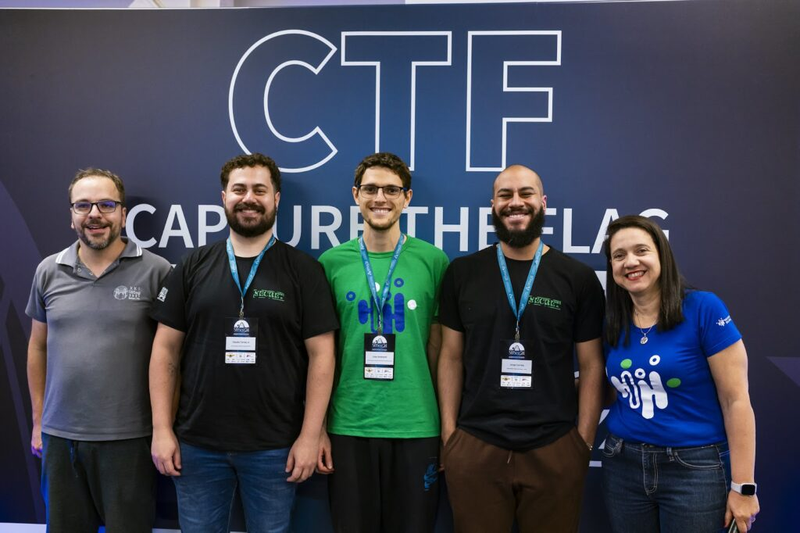

Durante o SBSEG 2024, tivemos a oportunidade de participar do CTF Hackers do Bem,
uma competição que coloca à prova habilidades práticas em segurança de sistemas
e redes em cenários realistas. Foi uma experiência intensa, de aprendizado e
colaboração, que rendeu destaque para a nossa equipe.

O CTF Hackers do Bem é promovido pela RNP e tem como objetivo incentivar a
formação de novos talentos em cibersegurança, fortalecendo a comunidade e
aproximando estudantes, pesquisadores e profissionais da área.

[Check out the news here.](https://gazzconecta.com.br/sem-categoria/pesquisadores-da-ufpr-conquistam-1o-lugar-em-maratona-nacional-de-ciberseguranca/)

