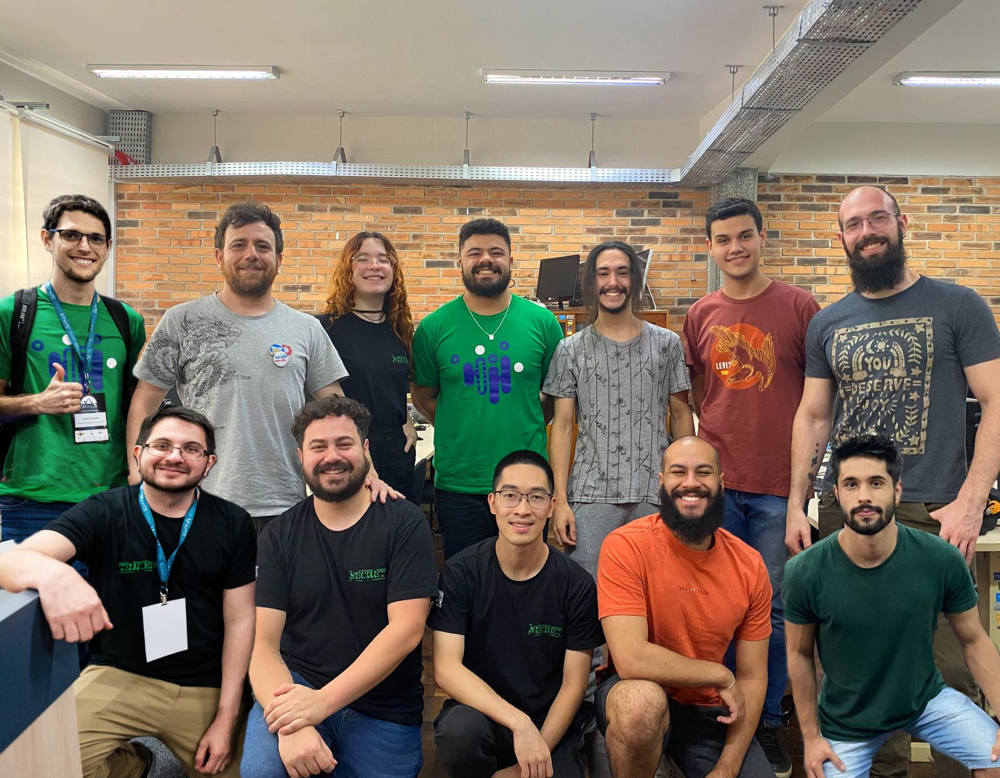

Pesquisadores da UFPR conquistaram um lugar de destaque no **iCTF 2024 (International Capture The Flag)**, competição internacional de segurança cibernética organizada pela UCSB (Universidade da Califórnia em Santa Bárbara) e Shellphish. A equipe da UFPR, única brasileira entre as dez melhores, garantiu a **quarta posição** entre 27 times de diversos países.

Com o nome “t0pSecRET”, a equipe reúne membros de graduação e pós-graduação dos grupos de pesquisa C3SL e SecRET (Security and Reverse Engineering Team), vinculados ao Departamento de Informática (DInf) da UFPR.

Esse resultado reforça a qualidade acadêmica e técnica da UFPR no cenário internacional de cibersegurança, evidenciando competências em áreas como exploração de vulnerabilidades web, forense digital, engenharia reversa e criptografia. Parabéns a todos os envolvidos!

[Check out the news here.](https://ufpr.br/pesquisadores-da-ufpr-estao-no-top-10-em-desafio-internacional-de-ciberseguranca/)

