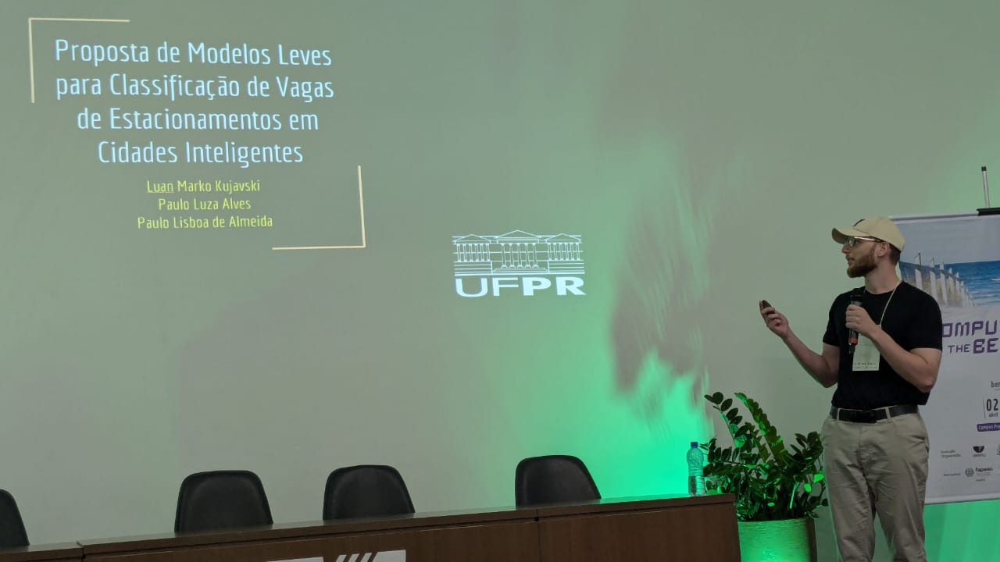

Pesquisadores do Departamento de Informática da UFPR obtiveram reconhecimento no **Computer On The Beach (COTB) 2025**, evento técnico-científico realizado na Univali, Itajaí, entre os dias 2 e 5 de abril. O trabalho “Proposta de Modelos Leves para Classificação de Vagas de Estacionamentos em Cidades Inteligentes” foi eleito **melhor trabalho** apresentado.

Desenvolvido pelo aluno de Ciência da Computação **Luan Marko Kujavski**, pelo mestrando Paulo Mateus Luza Alves, e orientado pelo professor Paulo Lisboa de Almeida, o estudo propõe arquiteturas leves de redes neurais convolucionais para identificar vagas de estacionamento ocupadas ou livres, otimizando sistemas urbanos de estacionamento em câmeras com recursos computacionais limitados.

Além desse artigo premiado, a UFPR apresentou **15 trabalhos** durante o COTB 2025, cobrindo temas como segurança cibernética, inteligência artificial aplicada, análise comportamental, sustentabilidade tecnológica e cidades inteligentes. A delegação paranaense foi liderada pelos professores Vinícius Fülber Garcia e Paulo Lisboa de Almeida.

Esse destaque reforça o compromisso da UFPR com pesquisa de impacto social e tecnológico, mostrando que iniciativas acadêmicas locais podem gerar contribuições relevantes para soluções de problemas urbanos e para os Objetivos de Desenvolvimento Sustentável da ONU.

[Check out the news here.](https://web.inf.ufpr.br/dinf/?p=2421)

