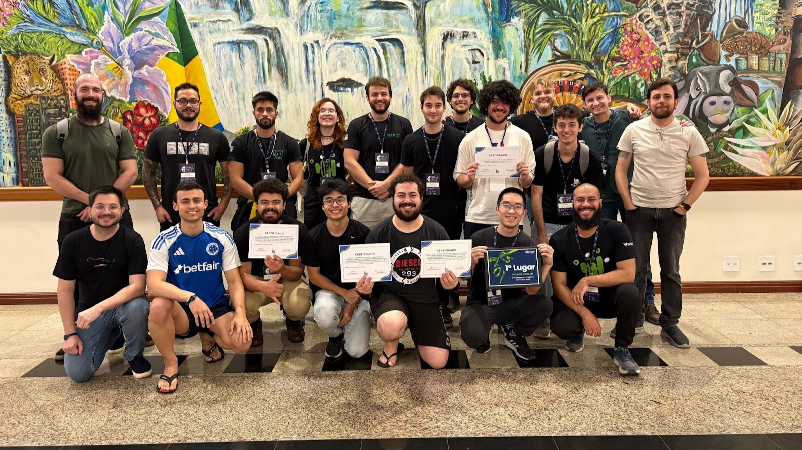

Os pesquisadores do grupo SecRET, do Departamento de Informática da UFPR, tiveram uma participação de destaque no **25º Simpósio Brasileiro de Cibersegurança (SBSeg) 2025**, que ocorreu entre 1 e 4 de setembro em Foz do Iguaçu – PR.

Entre as conquistas:

- **Prêmio Tempest** pelo artigo *“ARTEMIS: Uma Plataforma Modular para Execução, Monitoração e Investigação de Aplicativos Android Suspeitos”*
- **Artefato Destaque** com o trabalho *“Cordeiro em Pele de Lobo: Desvelando a Negação de Serviço Baseada em Envenenamento de Reputação”*
- **Menção Honrosa** na Trilha Principal de Sistemas
- **1º lugar** no 4º Hackathon do SBSEG / 3º Hackathon do Programa Hackers do Bem.

Essa série de reconhecimentos mostra a força da UFPR em pesquisa e inovação no campo da cibersegurança — tanto no rigor científico quanto na aplicação prática. Parabéns a toda equipe envolvida!

[Check out the news here.](https://ufpr.br/pesquisadores-da-ufpr-sao-premiados-em-evento-de-seguranca-digital/)

